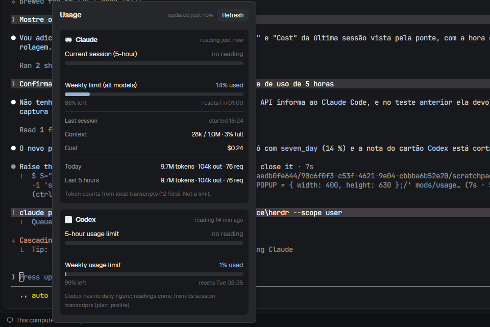

# herdr-usage-monitor

Claude and Codex rate limits in [Herdr](https://herdr.dev)'s status bar, with
a popup showing the 5-hour and weekly windows of each, the last Claude Code
session's context and cost, and today's token counts. Everything is read from
local files; nothing calls the providers.



Two pieces:

- `mods/usage-monitor/`: the Herdr mod (the bar and the popup).
- `claude-mod/usage-bridge/`: a Claude Code plugin that writes the account's
  rate-limit windows to `~/.claude/usage-monitor/rate-limits.json` after every
  turn, the only place the Herdr mod can read them from.

[RECIPE.md](RECIPE.md) describes what the mod shows, how it behaves, what it
was built from and what to watch out for.

## Install

### 1. The Claude Code plugin

At the prompt of a Claude Code terminal session:

```
/plugin install usage-bridge --marketplace AndersonSorrilha/herdr-usage-monitor
```

Answer `y` to add the marketplace and keep the user scope. From a checkout,
`claude plugin install usage-bridge --marketplace ./ --scope user` in this
folder does the same and reads the plugin from the folder itself.

### 2. The Herdr mod

Copy `mods/usage-monitor` into Herdr's mods folder (`~/.config/herdr-app/mods/`
unless `HERDR_APP_HOME` says otherwise), then put it in the status bar: clone
the shipped layout and point its `status` block at the mod.

```
herdr-app do layout.clone --name main --as main-usage
```

In `layouts/main-usage.json` change the `status` block's content to
`{ "mod": "usage-monitor" }`, then switch to the layout (`layout.switch`, or
the palette). `herdr-app check mods/usage-monitor` reports anything wrong.

Click either readout in the bar to open the popup; `mod.open
{name: "usage-monitor"}` toggles it too.

## License

MIT, see [LICENSE](LICENSE).
