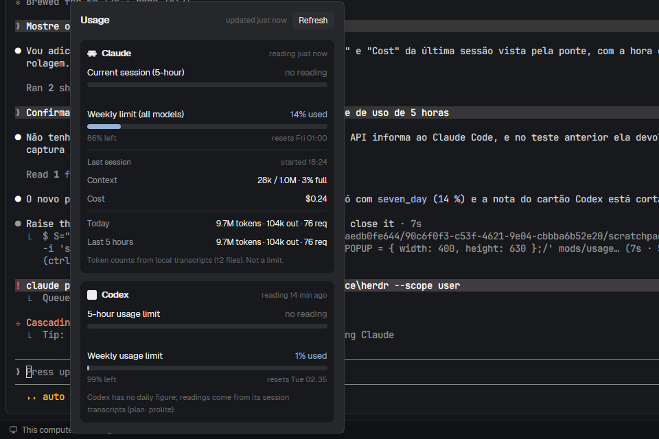

# Usage monitor

A status bar for Herdr that shows how much of the Claude and Codex rate limits
is used, and a popup with the full picture: the 5-hour window and the weekly
window of each, with a bar, the percent left and the reset time, plus
today's and the last 5 hours' token counts from Claude Code's local
transcripts. It reads local files only; nothing calls the providers.

## What you see

- **Status bar** (28 px, the layout's `status` block, `chrome` background,
  1 px `border` on top, 11.8 px `muted` text): left to right, the machine
  ("This computer" or the space's machine), the git branch when the space
  has one, the agent count with "· N needs you" in `blocked` when any agent
  is blocked; then, on the right, two readouts and the palette hint
  ("Ctrl+Shift+P  commands", read from keys.json as the shipped bar does).
- **A readout** is an icon (`icons/claude.svg` or `icons/codex.svg`, 13 px,
  tinted `muted`), the name in `foreground`, then two mini meters: "5h" and
  "wk", each a 36×5 px track in `raised` with a fill in the meter color and
  the percent beside it. With no reading the readout says "no bridge" (Claude
  without the bridge file), "not found" (no `~/.codex`) or "no reading".
- **Meter color:** `accent` below 70 % used, `ansi3` (amber) from 70 %, `ansi1`
  (red) from 90 %.
- **Popup** (400×630 px, `popover` background, 14 px padding): a header with
  "Usage", "updated N min ago" and a Refresh button (`raised` chip, `hover`
  when hovered), then two cards in `surface` with 8 px corners:
  - **Claude:** "Current session (5-hour)" and "Weekly limit (all models)",
    each with "N% used" on the right, a full-width 7 px bar, "N% left" and
    "resets at HH:MM" (or "resets Thu HH:MM" on another day). A divider,
    then "Last session" with "started HH:MM" on the right and two rows from
    the bridge file: "Context" ("27k / 1.0M · 3% full") and "Cost"
    ("$0.0023"; two decimals from one cent up, four below). Another divider,
    then "Today" and "Last 5 hours": "1.2M tokens · 45k out · 38 req", with
    the note "Token counts from local transcripts (N files). Not a limit."
  - **Codex:** "5-hour usage limit" and "Weekly usage limit" laid out the
    same way, and the note that Codex has no daily figure.
  - Each card's header shows "reading N min ago" in `dim`, in `ansi3` when
    the reading is older than 30 minutes (Claude) or 6 hours (Codex).

## How it behaves

- Click either readout, or anywhere on them, to open the popup at the
  pointer; click outside or press Esc to close it. `mod.open
  {name: "usage-monitor"}` toggles it too (bind it in keys.json if wanted).
- The bar re-reads the limit files every minute and the transcripts every
  five; the popup re-reads everything when it opens and when Refresh is
  pressed ("Refreshing…" while it runs). Readings are shared between the bar
  and the popup through `shared("usage-monitor.data")`, so the popup is
  filled the moment it opens.
- Agent statuses are not drawn by this mod beyond the "needs you" count;
  the agents list keeps that job.

## Built from

- `layouts/main-usage.json`: a clone of the shipped `main` layout
  (`layout.clone {name: "main", as: "main-usage"}`) whose `status` block's
  content is `{ "mod": "usage-monitor" }` instead of `workspace-status`.
  Nothing else differs. `ctrl-shift-l` switches back to `main`.
- `mods/usage-monitor/main.js`: the view. Without `props().overlay` it draws
  the bar; with it, the popup. `mod.json` sets `"place": "none"` and the
  popup's overlay size (`kind: "popup"`, 400×630) for `mod.open`; `POPUP`
  in main.js repeats it, since the popup root states its own height.
- `mods/usage-monitor/usage.js`: the readers, all through `fs/promises`
  (`readFile`, `readdir`, `exists`) under `home()`:
  - `~/.claude/usage-monitor/rate-limits.json`, written by the companion
    Claude Code mod in `claude-mod/usage-bridge/` (a function-hooks plugin
    hooking `session.start` and `session.measure`, writing
    `$.session.usage().rateLimits` with `updatedAt`). Kinds `five_hour` and
    `seven_day` fill the two rows; any other kind (a gateway's
    `spend_limit`) gets a row of its own. A window the account did not
    report (an account may send `seven_day` alone) stays "no reading". The
    file's `sessionStartedAt`, `context` (`tokens`, `window`, `percent`) and
    `cost.usd` fill the "Last session" rows: the last Claude Code session
    the bridge measured, not necessarily the one in front of you.
- `.claude-plugin/marketplace.json` at the repository root: the local
  marketplace that lists `usage-bridge` with `"source":
  "./claude-mod/usage-bridge"`, so `claude plugin install usage-bridge
  --marketplace ./ --scope user`, run in this folder, installs it for every
  session and reads it from here (`/reload-plugins` after an edit); the
  source must be spelled `./…`, a Windows path is refused. Until installed,
  `claude --plugin-dir /path/to/herdr/claude-mod/usage-bridge` loads it for
  one session.
  - `~/.claude/projects/*/*.jsonl`: `assistant` rows with `message.usage`,
    de-duplicated by `message.id`, within the last 24 hours. Input counts
    uncached, cache-write and cache-read tokens together.
  - `~/.codex/sessions/YYYY/MM/DD/*.jsonl`: the newest line holding
    `rate_limits` in the eight newest files; `primary`/`secondary` windows
    are matched by `window_minutes` (300 and 10080), never by position: a
    plan with only a weekly limit reports it as `primary` with `secondary`
    null, so a missing window stays "no reading" and any other window
    length gets a row of its own. `resets_at` (unix seconds) or
    `resets_in_seconds` give the reset time; `plan_type` is shown in the
    card's note.
- Herdr functions: `theme`, `spaces`, `agents`, `keys`, `window`, `run`
  (`app.palette`), `openOverlay`, `shared`/`setShared`, `home`, `checking`,
  `props`. Icons: `icons/claude.svg`, `icons/codex.svg`,
  `mods/workspace-chrome/{monitor,server,branch}.svg`.

## Watch out

- Claude Code does not keep its rate limits in any file: the bridge mod is
  the only source. Without it the Claude card says "No reading yet" and the
  bar says "no bridge". The bridge keeps the last good file while a session
  has no reading yet.
- The bridge must be installed in Claude Code (user scope) or the file is
  never written: a session started before the install does not load it.
  `claude plugin install` is a terminal command a person runs; an agent's
  attempt to run it may be refused as a settings change.
- The Herdr copy of the mod lives in `~/.config/herdr-app/mods/usage-monitor`
  (`HERDR_APP_HOME` picks another home) and is a copy, not a link: an edit
  under `mods/` here has to be copied there to show up.
- `fs/promises` has no `stat`, so transcripts are read whole. A file whose
  last timestamp is older than 24 hours is skipped after one scan, and a
  file whose length has not changed is not parsed again, but a very large
  live transcript is still re-read every five minutes.
- Only top-level transcript files are counted (not sub-agent folders).
- A popup is sized by its content: the popup root states its height
  (`h(538)`); a `flex_1()` body under a `size_full()` root drew nothing.
- `"place": "bottom"` in mod.json did not dock the mod into the shipped
  `main` layout at hot-reload time, which is why the layout is cloned.
- Codex versions that stop writing `rate_limits` into session transcripts
  would leave the Codex card at "No rate-limit reading".

## Done when

- `herdr-app check mods/usage-monitor` passes.
- With `main-usage` shown, the status bar ends with the two readouts and
  the palette hint, and clicking a readout opens the popup.
- With a bridge file holding `five_hour` 36 % and `seven_day` 57 %, the
  Claude readout shows "5h 36%" and "wk 57%" in the accent color, and the
  popup's Claude card shows two bars with "64% left" and "43% left".
- A value of 70 % or more draws amber, 90 % or more red.
- Refresh in the popup re-reads the files and updates "updated just now".
- Verified 2026-11-17: `claude -p` with `--plugin-dir` on the bridge wrote
  the file (`seven_day` 14 %, no `five_hour`), and the bar showed
  "Claude 5h – wk 14%" with the popup's Claude card at "14% used · 86% left"
  and the 5-hour row at "no reading".
